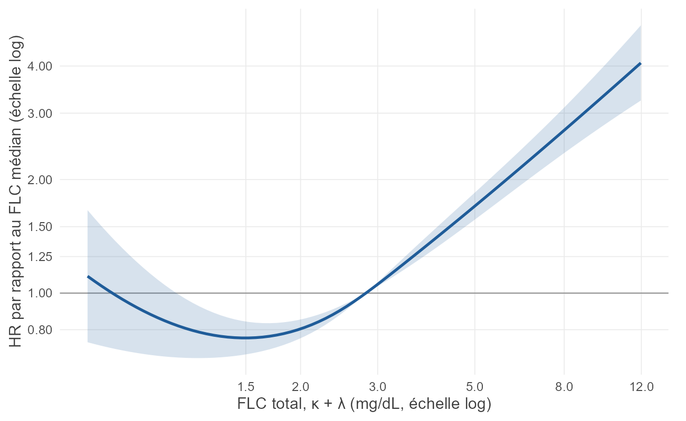
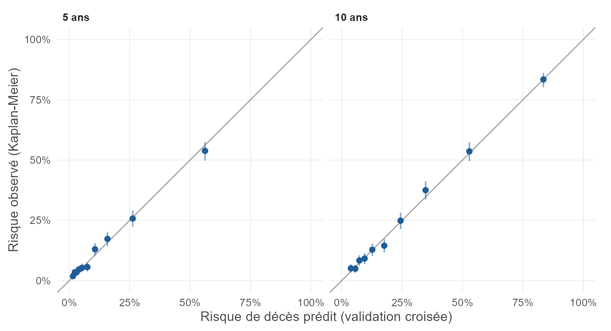
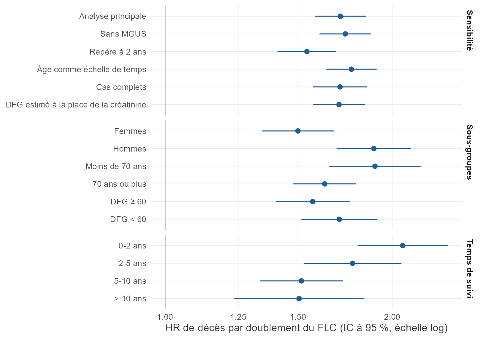
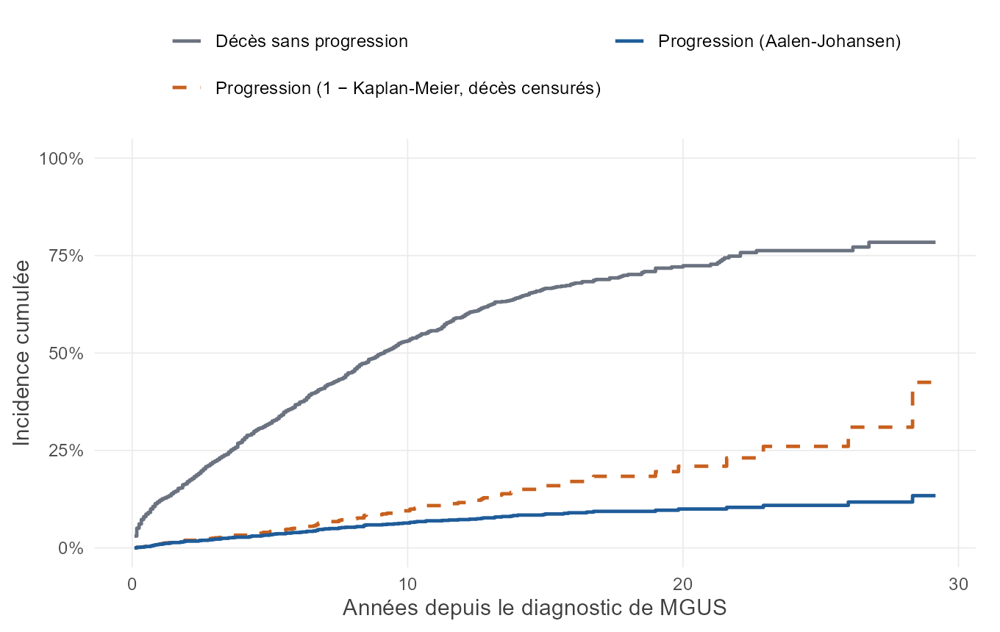
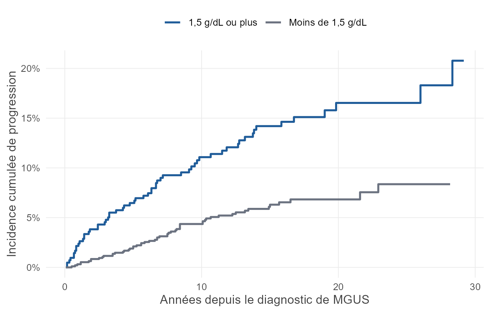

```{r}
library(knitr)
source("../R/rapport_utils.R")
flux <- lire("flux.csv"); n <- setNames(flux$n, paste(flux$partie, flux$etape))
ef <- lire("A_effets.csv"); pr <- ef[3, ]; ra <- ef[4, ]
dc <- lire("A_delta_c.csv"); dcs <- lire("A_delta_c_spline.csv"); cn <- lire("A_concordance.csv")
auc <- lire("A_auc_t.csv"); aucc <- lire("A_auc_contraste.csv"); bri <- lire("A_brier.csv")
pente <- lire("A_pente_calibration.csv"); sens <- lire("A_sensibilite.csv")
sg <- lire("A_sous_groupes.csv"); par <- lire("A_hr_par_suivi.csv"); forme <- lire("A_forme.csv")
prof <- lire("A_profils.csv"); ev <- lire("A_evalue.csv"); dec <- lire("A_decision.csv")
ta <- lire("A_taille_echantillon.csv"); mq <- lire("A_manquants_par_periode.csv")
cause <- lire("A_causes.csv"); zph <- lire("A_schoenfeld.csv"); rm <- lire("A_ratio_mgus.csv")
desc_a <- lire("A_descriptif.csv")
ci <- lire("B_incidence.csv"); gr <- lire("B_gray.csv"); cg <- lire("B_incidence_groupes.csv")
mo <- lire("B_modeles.csv"); au <- lire("B_auc.csv"); ac <- lire("B_auc_contraste.csv")
br <- lire("B_brier.csv"); pb <- lire("B_profils.csv"); db <- lire("B_decision.csv")
tb <- lire("B_taille_echantillon.csv"); ri <- lire("B_riley.csv"); sb <- lire("B_sous_groupes.csv")
sbe <- lire("B_sensibilite.csv"); fb <- lire("B_forme.csv"); zb <- lire("B_schoenfeld.csv")
cs <- mo[mo$modele == "Cox par cause : progression", ]
csd <- mo[mo$modele == "Cox par cause : décès sans progression", ]
fg <- mo[mo$modele == "Fine-Gray : progression", ]
c10 <- ci[ci$horizon == 10, ]; c20 <- ci[ci$horizon == 20, ]; c30 <- ci[ci$horizon == 30, ]
g <- function(gr_, h) cg[cg$groupe == gr_ & cg$horizon == h, ]
a10 <- ac[ac$times == 10 & ac$model == "+ pic monoclonal" & ac$reference == "Âge et sexe", ]
a20 <- ac[ac$times == 20 & ac$model == "+ pic monoclonal" & ac$reference == "Âge et sexe", ]
```

::: {.callout-note appearance="simple" title="Résumé"}
**Chaînes légères libres (FLC).** Dans la population générale de 50 ans ou plus, un doublement du FLC est associé à une hausse de `r virg((pr$hr - 1) * 100, 0)` % du risque instantané de décès après ajustement (HR `r virg(pr$hr)`, IC à 95 % `r ic(pr$bas, pr$haut)`). Le gain de discrimination reste modeste : `r virg(dc$delta_c, 3)` sur le C de Harrell, sous le seuil de 0,01 fixé à l'avance. **Décision selon la règle prévue : réorienter.**

**Pic monoclonal.** Dans la MGUS, chaque g/dL supplémentaire multiplie par `r virg(cs$hr[1])` le risque instantané de progression (IC à 95 % `r ic(cs$bas[1], cs$haut[1])`). À 20 ans, le risque de progression estimé est de `r pct(c20$prog_aj)`, contre `r pct(c20$prog_1_km)` si l'on censure les décès. Le gain d'AUC à 10 ans est important en estimation ponctuelle, mais trop imprécis pour conclure avec `r n["B Progressions, cas complets"]` progressions. **Le critère de décision n'est pas rempli : il faut davantage d'événements.**
:::

# Objectif

Ce projet porte sur une question simple : un biomarqueur associé au risque est-il utile pour estimer ce risque ? L'étude distingue trois niveaux de preuve : l'association, la valeur ajoutée par rapport aux données déjà disponibles et la robustesse aux biais.

Le plan d'analyse, les biais anticipés et les critères de décision sont décrits dans le [plan d'analyse statistique](plan_analyse_statistique.html). Le plan a été rédigé avant tout ajustement de modèle sur les critères de jugement. Les données étant publiques et déjà publiées, il n'a pas valeur de préenregistrement. Ces analyses restent rétrospectives et ne constituent pas une validation clinique.

# Partie A : FLC et mortalité

## Population

```{r}
#| label: tbl-a
#| tbl-cap: "Caractéristiques selon le quartile de FLC total"
t <- lire("A_descriptif.csv")
d <- t(t[, c("n", "Âge médian (ans)", "Femmes (%)", "FLC médian (mg/dL)", "Créatinine médiane (mg/dL)", "Rapport κ/λ anormal (%)", "MGUS (%)", "Créatinine manquante (%)", "Décès (%)", "Suivi médian (ans)")])
colnames(d) <- t$groupe
d <- apply(d, 2, function(x) c(virg(x[1], 0), virg(x[2], 0), virg(x[3:10], 1)))
rownames(d) <- c("Effectif", "Âge médian (ans)", "Femmes (%)", "FLC médian (mg/dL)", "Créatinine médiane (mg/dL)", "Rapport κ/λ anormal (%)", "MGUS (%)", "Créatinine manquante (%)", "Décès (%)", "Suivi médian (ans)")
kable(d, align = "r")
```

L'analyse porte sur `r format(n["A Inclus"], big.mark = " ")` sujets et `r format(n["A Décès"], big.mark = " ")` décès. L'âge médian passe de `r desc_a[desc_a$groupe == "Q1", "Âge médian (ans)"]` ans dans le premier quartile à `r desc_a[desc_a$groupe == "Q4", "Âge médian (ans)"]` ans dans le dernier : une analyse brute serait donc fortement confondue par l'âge.

La créatinine manque pour `r pct(n["A Créatinine manquante"] / n["A Inclus"])` des sujets. Elle manque pour `r virg(mq$manquante_pct[5], 0)` % des sujets prélevés en 2002-2003, contre `r virg(min(mq$manquante_pct[1:4]), 0)` à `r virg(max(mq$manquante_pct[1:4]), 0)` % avant. Ces derniers recrutés sont aussi plus jeunes et ont moins de décès observés. C'est la raison de l'imputation multiple et de la stratification sur la période.

**Taille d'échantillon.** Avec une corrélation entre le marqueur et les covariables (R² = `r virg(ta$r2_covariables)`), il faut `r format(ta$deces_requis_hr_1_20, big.mark = " ")` décès pour détecter un HR de 1,20 par doublement avec 90 % de puissance. Les `r format(ta$deces, big.mark = " ")` décès disponibles permettent de détecter un HR de `r virg(ta$hr_min_detectable)`.

## Association

```{r}
#| label: tbl-effets
#| tbl-cap: "HR de décès par doublement du FLC, et pour un rapport κ/λ anormal"
x <- data.frame(Modèle = ef$modele, HR = virg(ef$hr), `IC à 95 %` = ic(ef$bas, ef$haut), p = pv(ef$p), check.names = FALSE)
kable(x, align = "lrrr")
```

L'ajustement divise fortement l'effet brut : le HR passe de `r virg(ef$hr[1])` à `r virg(pr$hr)`. L'âge explique l'essentiel de cette baisse. Le rapport κ/λ anormal n'apporte pas d'information mesurable une fois le FLC total pris en compte, mais seuls `r sum(rm$n[rm$ratio_anormal == 1])` sujets ont un rapport anormal : cet intervalle reste très large. Surtout, dans ce fichier, le rapport anormal se confond avec la MGUS : les `r sum(rm$n[rm$ratio_anormal == 1])` sujets concernés ont tous une MGUS, et seul `r sum(rm$n[rm$ratio_anormal == 0 & rm$mgus == 1])` sujet atteint de MGUS a un rapport normal. Cette analyse ne distingue donc pas l'effet du rapport de celui de la MGUS. Ces sujets ont aussi un FLC total bas (médiane `r virg(rm$flc_median[rm$ratio_anormal == 1])` mg/dL contre `r virg(rm$flc_median[rm$ratio_anormal == 0 & rm$mgus == 0])` mg/dL), ce qui est inattendu pour une gammapathie : c'est une particularité du fichier public à signaler plutôt qu'à interpréter.

La relation n'est pas linéaire (p `r pv(forme$p_non_lineaire)`). Le risque est plat dans les valeurs basses et augmente surtout au-dessus de la médiane (@fig-courbe). Le HR par doublement est donc un résumé moyen.

{#fig-courbe width=85%}

L'effet diminue avec le temps (test de Schoenfeld pour le FLC : p = `r pv(zph$p[zph$terme == "log2flc"])`). Le HR passe de `r virg(par$hr[1])` dans les deux premières années à `r virg(par$hr[4])` après dix ans. Le biomarqueur reste associé au risque à long terme, mais le HR principal résume un effet qui n'est pas constant. L'âge ne respecte pas non plus l'hypothèse de proportionnalité (p `r pv(zph$p[zph$terme == "ns(age, 3)"])`). L'analyse qui prend l'âge comme échelle de temps ne fait pas cette hypothèse pour l'âge, et elle donne un HR proche (`r virg(sens$hr[sens$analyse == "Âge comme échelle de temps"])`) : l'ajustement imparfait sur l'âge ne modifie donc pas la conclusion.

## Valeur ajoutée

```{r}
#| label: tbl-perf
#| tbl-cap: "Performances sans et avec le FLC (cas complets)"
gain <- function(m, t) auc$AUC[auc$model == m & auc$times == t]
b <- function(m, t) bri$Brier[bri$model == m & bri$times == t]
x <- data.frame(
  Mesure = c("C de Harrell, corrigé de l'optimisme", "AUC à 5 ans", "AUC à 10 ans", "Brier à 5 ans", "Brier à 10 ans"),
  Base = c(virg(cn$c_corrige[1], 3), virg(gain("Base", 5), 3), virg(gain("Base", 10), 3), virg(b("Base", 5), 3), virg(b("Base", 10), 3)),
  `Base + FLC` = c(virg(cn$c_corrige[2], 3), virg(gain("Base + FLC", 5), 3), virg(gain("Base + FLC", 10), 3), virg(b("Base + FLC", 5), 3), virg(b("Base + FLC", 10), 3)),
  check.names = FALSE)
kable(x, align = "lrr")
```

Le modèle de base discrimine déjà bien, car l'âge porte l'essentiel du pronostic. Le FLC ajoute `r virg(dc$delta_c, 3)` sur le C (IC à 95 % `r ic(dc$bas, dc$haut, 3)`), et `r virg(aucc$delta.AUC[1], 3)` puis `r virg(aucc$delta.AUC[2], 3)` sur l'AUC à 5 et 10 ans. Ce gain est réel statistiquement, mais il reste faible. L'AUC et le score de Brier sont des mesures apparentes, calculées sur les données d'ajustement : avec 7 paramètres et près de 2 000 décès, l'optimisme mesuré par bootstrap sur le C est inférieur à 0,001. Modéliser la non-linéarité le porte à `r virg(dcs$delta_c, 4)` (IC à 95 % `r ic(dcs$bas, dcs$haut, 3)`), légèrement au-dessus du seuil. Cette analyse exploratoire a été décidée après avoir vu les résultats : elle ne change pas le critère, mais elle confirme que le résultat est à la limite.

Pour une femme de 65 ans avec une créatinine à 1 mg/dL, le risque de décès à 10 ans est estimé à `r pct(prof$risque10[1])` au 1er quartile de FLC, `r pct(prof$risque10[3])` au 3e quartile et `r pct(prof$risque10[4])` au 95e percentile (modèle linéaire, strate 1996). Une différence de risque visible peut donc coexister avec un faible gain de discrimination.

{#fig-cal width=90%}

La calibration est bonne : pente de `r virg(pente$pente[1])` à 5 ans et `r virg(pente$pente[2])` à 10 ans (@fig-cal). Le rapport observé/attendu vaut `r virg(pente$oe[1])` aux deux horizons.

## Robustesse

{#fig-foret width=95%}

L'effet résiste aux cinq analyses de sensibilité (@fig-foret). Il diminue le plus avec l'analyse de repère à 2 ans (HR `r virg(sens$hr[3])`), ce qui suggère qu'une partie du signal précoce reflète une maladie déjà présente. L'E-value est de `r virg(ev$evalue_point)` (`r virg(ev$evalue_bas)` pour la borne basse de l'IC). Un facteur de confusion non mesuré devrait être associé au FLC et au décès avec cette force pour annuler le résultat, ce qui n'est pas invraisemblable face à l'âge biologique ou aux comorbidités.

L'association est de même ordre pour les décès circulatoires (HR `r virg(cause$hr[1])`), les cancers (HR `r virg(cause$hr[2])`) et les causes respiratoires (HR `r virg(cause$hr[3])`). Ce résultat exploratoire évoque un marqueur général d'état de santé plutôt qu'un marqueur spécifique d'une maladie.

**Les résultats en sous-groupes ne permettent pas de conclure.** Le test dépend de la spécification :

```{r}
#| label: tbl-sg
#| tbl-cap: "Interactions avec le FLC : la conclusion change avec la forme du modèle (p corrigés par Holm)"
u <- sg[!duplicated(sg$variable), ]
x <- data.frame(Interaction = c("Sexe", "Âge (< 70 / ≥ 70 ans)", "DFG estimé (< 60 / ≥ 60)"),
  `Ajustement commun` = pv(u$holm_commun), `Ajustement propre à chaque sous-groupe` = pv(u$holm_stratifie), check.names = FALSE)
kable(x, align = "lrr")
```

Pour le sexe, le test avec ajustement commun impose le même effet de la créatinine chez les hommes et les femmes. Or la créatinine n'a pas la même signification selon le sexe, car elle dépend notamment de la masse musculaire. Pour l'âge, c'est l'inverse : le signal disparaît lorsque les ajustements varient. Une hétérogénéité par sexe ou par âge reste possible, mais elle doit être testée de nouveau avant de fonder une stratégie par sous-population.

## Comparaison à la publication d'origine

```{r}
cp <- lire("A_comparaison_publication.csv")
```

La publication d'origine compare le décile supérieur de FLC (≥ 4,72 mg/dL) au reste de la population, après exclusion des troubles plasmocytaires connus. Avec une définition proche, ce sous-échantillon public donne un HR ajusté de `r virg(cp$hr[2])` (IC à 95 % `r ic(cp$bas[2], cp$haut[2])`), contre 2,1 (1,9 à 2,2) dans la publication. Les données et les exclusions diffèrent, mais l'ordre de grandeur est retrouvé.

## Décision

```{r}
#| label: tbl-dec
#| tbl-cap: "Application des critères fixés à l'avance"
x <- data.frame(Critère = dec$critere, Règle = dec$regle, Résultat = oui_non(dec$rempli))
kable(x, align = "llr")
```

**Décision : réorienter.** Le FLC est associé de façon robuste à la mortalité, mais ce travail ne démontre pas qu'il améliore suffisamment l'estimation du risque individuel dans la population générale, où l'âge domine déjà. Le gain de C est proche du seuil, et ce seuil est une convention : le résultat ne doit pas être lu comme un arrêt net. La prochaine étape serait de tester le marqueur là où l'âge discrimine moins, ou sur une décision précise, plutôt que de répéter la même étude.

# Partie B : pic monoclonal et progression de la MGUS

## Population

```{r}
#| label: tbl-b
#| tbl-cap: "Caractéristiques au diagnostic de MGUS"
t <- lire("B_descriptif.csv")
cols <- c("n", "Âge médian (ans)", "Femmes (%)", "M-spike médian (g/dL)", "Hémoglobine médiane (g/dL)", "Créatinine médiane (mg/dL)", "Progression (%)", "Décès sans progression (%)")
d <- t(t[, cols]); colnames(d) <- t$groupe
d <- apply(d, 2, function(x) c(virg(x[1], 0), virg(x[2], 0), virg(x[3:8], 1)))
rownames(d) <- c("Effectif", cols[-1])
kable(d, align = "r")
```

Sur `r format(n["B Inclus"], big.mark = " ")` patients, on observe `r n["B Progressions"]` progressions, `r n["B Décès sans progression"]` décès sans progression et `r n["B Censurés"]` censures. Le décès est donc plus de sept fois plus fréquent que la progression, ce qui rend l'analyse à risques concurrents indispensable. La documentation du package évoque 1 341 patients, alors que le jeu en contient 1 384 : c'est ce dernier chiffre qui est retenu.

**Taille d'échantillon.** Le modèle complet compte 5 paramètres pour `r tb$progressions` progressions, soit `r virg(tb$epv, 1)` événements par paramètre. Les critères de Riley demandent `r format(ri$n_requis[2], big.mark = " ")` patients si le R² de Cox-Snell attendu est de 0,05, et `r format(ri$n_requis[1], big.mark = " ")` s'il est de 0,03. Ce dernier scénario dépasse les `r format(tb$n, big.mark = " ")` patients disponibles : l'effectif est donc juste pour un modèle prédictif.

## Pourquoi tenir compte du décès

{#fig-aj width=85%}

```{r}
#| label: tbl-cif
#| tbl-cap: "Risque de progression : méthode à risques concurrents et méthode naïve"
x <- data.frame(Horizon = paste(ci$horizon, "ans"),
  `Aalen-Johansen` = pct(ci$prog_aj), `IC à 95 %` = paste0(virg(100 * ci$prog_bas, 1), " à ", virg(100 * ci$prog_haut, 1), " %"),
  `1 − Kaplan-Meier` = pct(ci$prog_1_km), `Surestimation` = paste0("× ", virg(ci$prog_1_km / ci$prog_aj, 1)), check.names = FALSE)
kable(x, align = "lrrrr")
```

Censurer les décès fait comme si les patients décédés pouvaient encore progresser. À 30 ans, le risque serait estimé à `r pct(c30$prog_1_km)` au lieu de `r pct(c30$prog_aj)` (@tbl-cif), une erreur importante pour informer un patient ou planifier un suivi. L'estimation à 30 ans reste fragile : seuls `r c30$a_risque` patients sont encore à risque à cet horizon. L'horizon de 20 ans (`r c20$a_risque` patients à risque) est plus fiable.

## Effet du pic monoclonal

```{r}
#| label: tbl-mod
#| tbl-cap: "Modèles multivariés : les deux approches répondent à deux questions différentes"
x <- data.frame(Variable = cs$terme, `Progression (par cause)` = paste0(virg(cs$hr), " (", ic(cs$bas, cs$haut), ")"),
  `Décès sans progression (par cause)` = paste0(virg(csd$hr), " (", ic(csd$bas, csd$haut), ")"),
  `Progression (Fine-Gray)` = paste0(virg(fg$hr), " (", ic(fg$bas, fg$haut), ")"), check.names = FALSE)
kable(x, align = "lrrr")
```

Le pic monoclonal prédit la progression et non le décès sans progression : son HR dans ce dernier modèle est de `r virg(csd$hr[1])` (IC à 95 % `r ic(csd$bas[1], csd$haut[1])`). Il n'y a pas de signe de non-linéarité (p = `r pv(fb$p_non_lineaire)`) ni de non-proportionnalité (test global p = `r pv(zb$p[zb$terme == "GLOBAL"])`).

**L'âge illustre bien la différence entre les deux modèles.** Dans le modèle par cause, l'âge n'est pas significativement lié à la progression (HR `r virg(cs$hr[2])`, IC à 95 % `r ic(cs$bas[2], cs$haut[2])`). Dans le modèle de Fine-Gray, il la réduit (HR `r virg(fg$hr[2])`). L'âge ne protège pas biologiquement : les patients âgés meurent plus souvent avant de progresser, donc ils cumulent moins de progressions. Le modèle par cause répond à la question du mécanisme, celui de Fine-Gray à celle du risque absolu.

{#fig-pic width=75%}

À 20 ans, le risque de progression est de `r pct(g("1,5 g/dL ou plus", 20)$p)` avec un pic d'au moins 1,5 g/dL, contre `r pct(g("Moins de 1,5 g/dL", 20)$p)` en dessous (test de Gray p `r pv(gr$p[1])`, @fig-pic). Selon le modèle de Fine-Gray, une femme de 60 ans avec une hémoglobine à 13 g/dL et une créatinine à 1 mg/dL aurait un risque à 20 ans de `r pct(pb$risque20[1])` pour un pic de 0,5 g/dL et de `r pct(pb$risque20[3])` pour un pic de 2,5 g/dL.

Les interactions avec le sexe et l'âge ne sont pas significatives, mais ces tests manquent de puissance avec `r tb$progressions` progressions. L'ajustement sur l'année de diagnostic ne modifie pas l'effet (HR `r virg(sbe$hr[2])`).

## Valeur ajoutée et décision

```{r}
#| label: tbl-auc
#| tbl-cap: "AUC de progression dépendante du temps, en validation croisée bootstrap (100 réplications)"
f <- function(m, t) { r <- au[au$model == m & au$times == t, ]; paste0(virg(r$AUC), " (", ic(r$lower, r$upper), ")") }
m <- c("Âge et sexe", "+ pic monoclonal", "+ pic, Hb, créatinine")
x <- data.frame(Modèle = m, `10 ans` = sapply(m, f, t = 10), `20 ans` = sapply(m, f, t = 20), check.names = FALSE, row.names = NULL)
kable(x, align = "lrr")
```

Le pic monoclonal ajoute `r virg(a10$delta.AUC)` à l'AUC à 10 ans, mais l'intervalle de cette différence est très large (`r ic(a10$lower, a10$upper)`) et comprend 0. Ajouter l'hémoglobine et la créatinine n'améliore pas la discrimination. Même avec le pic monoclonal, l'AUC reste moyenne : ce marqueur seul ne suffit pas à bien classer les patients.

**Décision : critère non rempli, à cause de l'imprécision.** Le pic monoclonal est associé à la progression, mais ces données ne suffisent pas à prouver un gain de discrimination. Il faudrait une cohorte avec davantage de progressions ou une validation externe, ainsi que l'évaluation d'autres biomarqueurs, notamment le type d'immunoglobuline et le rapport κ/λ, qui ne sont pas disponibles ici.

# Limites

- **Données rétrospectives :** une association pronostique ne prouve pas de causalité et ne montre pas qu'agir sur le marqueur modifie le risque.
- **Portée :** les deux cohortes viennent du Minnesota et d'une seule institution ou d'un seul comté. Les résultats ne sont pas transposables sans validation externe.
- **Validation :** uniquement interne.
- **Dosages et époques :** les données couvrent plusieurs décennies pour la MGUS, avec des pratiques différentes. Le jeu ne permet pas d'étudier la variabilité analytique des dosages.
- **Sous-échantillon :** `flchain` contient environ la moitié de la cohorte d'origine. Ses résultats peuvent différer légèrement des publications.
- **Imputation et interactions :** le modèle d'imputation ne contient pas les produits du FLC avec le sexe, l'âge ou la fonction rénale. Les tests d'interaction sur données imputées sont donc légèrement tirés vers l'absence d'effet.
- **Rapport κ/λ :** dans `flchain`, il se confond avec la MGUS. Sa valeur propre ne peut pas être étudiée ici.
- **Biomarqueur prédictif :** aucune donnée randomisée n'étant disponible, ce travail ne dit rien de la réponse à un traitement.

# Déviations par rapport au plan

1. **Tests d'interaction (Partie A).** Le plan ne fixait pas la forme du test. Un écart entre les HR par sexe et le test à ajustement commun a conduit à rapporter aussi un test avec des ajustements propres à chaque sous-groupe. Les deux sont présentés, et aucun n'a été choisi selon son résultat.
2. **Mesures à 5 et 10 ans (Partie A).** La strate 2002-2003 a été retirée de l'AUC, du Brier et de la calibration, car ses 25 cas complets n'ont pas 10 ans de suivi.
3. **Gain de C avec spline (Partie A).** Analyse exploratoire ajoutée après avoir constaté la non-linéarité. Le critère C3 reste évalué sur le modèle prévu.

# Références {.unnumbered}

- Dispenzieri A, et al. Use of nonclonal serum immunoglobulin free light chains to predict overall survival in the general population. *Mayo Clin Proc.* 2012;87:517-523.
- Kyle RA, et al. Prevalence of monoclonal gammopathy of undetermined significance. *N Engl J Med.* 2006;354:1362-1369.
- Kyle RA, et al. A long-term study of prognosis in monoclonal gammopathy of undetermined significance. *N Engl J Med.* 2002;346:564-569.
- Rajkumar SV, et al. Serum free light chain ratio is an independent risk factor for progression in monoclonal gammopathy of undetermined significance. *Blood.* 2005;106:812-817.
- McShane LM, et al. Reporting recommendations for tumor marker prognostic studies (REMARK). *J Natl Cancer Inst.* 2005;97:1180-1184.
- Fine JP, Gray RJ. A proportional hazards model for the subdistribution of a competing risk. *J Am Stat Assoc.* 1999;94:496-509.
- Putter H, Fiocco M, Geskus RB. Tutorial in biostatistics: competing risks and multi-state models. *Stat Med.* 2007;26:2389-2430.
- White IR, Royston P. Imputing missing covariate values for the Cox model. *Stat Med.* 2009;28:1982-1998.
- Riley RD, et al. Calculating the sample size required for developing a clinical prediction model. *BMJ.* 2020;368:m441.
- VanderWeele TJ, Ding P. Sensitivity analysis in observational research: introducing the E-value. *Ann Intern Med.* 2017;167:268-274.
- Inker LA, et al. New creatinine- and cystatin C-based equations to estimate GFR without race. *N Engl J Med.* 2021;385:1737-1749.

Sessions et versions des packages : voir `session_info.txt` dans le dépôt.
